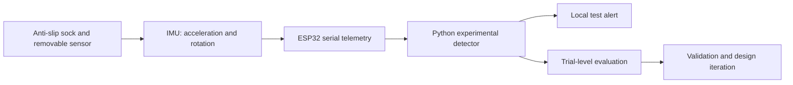

# SafeStepSocks

**Wearable fall-safety concept | anti-slip footwear + motion sensing + caregiver alerts**

> **Prototype / research repository — not a medical device or emergency-response service.**
> The code is exploratory, not clinically validated, and must not be used to make safety-critical decisions.

SafeStepSocks explores whether a comfortable everyday sock can combine **anti-slip soles**, **removable inertial sensing**, **fall-event detection**, **caregiver notifications**, **compression-inspired fit**, and **thermal comfort**. The goal is to develop an accessible fall-safety product for people with increased fall risk, while evaluating real-world limitations transparently.

## What is included

- **Reference firmware:** stream accelerometer and gyroscope readings from an ESP32 + MPU6050 over USB serial.
- **Python proof-of-concept:** a transparent, threshold-based motion detector, with a configurable state machine.
- **Data tools:** generate clearly labeled synthetic example trials, evaluate trial-level performance, and optionally monitor a connected sensor.
- **Tests & CI:** automated checks for detector behavior and reporting logic.
- **Technical and product documentation:** hardware, validation, adoption, risks, privacy and intellectual property.

**Not included:** an operational emergency-notification backend, a validated fall classifier, a production mobile app, clinical datasets, medical-device certification, or confirmed institutional partnerships.

## Architecture



## Quick start (Python 3.10+)

```bash
python -m venv .venv
source .venv/bin/activate  # Windows: .venv\Scripts\activate
python -m pip install -e .
python scripts/generate_synthetic_data.py
python scripts/evaluate_csv.py data/synthetic_trials.csv
python scripts/demo.py
python -m unittest discover -s tests -v
```

The sample CSV is **synthetic and illustrative**. Its performance results are **not evidence** of product accuracy.

## Hardware proof-of-concept

1. Follow [docs/hardware.md](docs/hardware.md) for ESP32 + MPU6050 wiring and library setup.
2. Upload [`firmware/esp32_mpu6050/esp32_mpu6050.ino`](firmware/esp32_mpu6050/esp32_mpu6050.ino).
3. For a live **console-only** experiment, install `pyserial` and run:

```bash
python -m pip install pyserial
python scripts/live_monitor.py --port /dev/ttyUSB0
```

Change the port to your serial device (e.g., `COM3`). **No real emergency notifications are sent.** Do not rely on the demonstration for personal safety.

## Project status

| Workstream | Status |
| --- | --- |
| Concept and high-level product definition | Documented |
| Sample embedded IMU streaming | Reference code (hardware testing required) |
| Experimental fall-event detector | Implemented in Python |
| Automated software tests | Included |
| Real-user comfort and usability study | Team-reported information; records not supplied here |
| False-alarm performance | Team-reported 2% after iteration; definition/raw data not supplied |
| Clinical fall-detection performance | Not established |
| Wireless caregiver-alert production app | Not implemented |
| Clinical partners and commercial deployment | Exploration stage |

See [docs/evidence-register.md](docs/evidence-register.md) for how to describe prior project claims without overstating evidence.

## Product differentiation to investigate

Unlike a standalone wrist alert, a sock could potentially integrate traction and motion sensing in the same garment. However, smart socks and anti-slip hospital socks already exist; the team must test whether a **portable, maintainable, accessible, modular** design offers meaningful advantages. Claims of fall prevention, therapeutic compression, or better performance than competitors require comparative evidence.

## Documentation

| Document | Purpose |
| --- | --- |
| [Architecture](docs/architecture.md) | Components, telemetry, detection flow |
| [Hardware](docs/hardware.md) | Parts, wiring, sensor placement |
| [Validation](docs/validation.md) | Protocol, metrics, bias, definitions |
| [Evidence register](docs/evidence-register.md) | Evidence status and claim discipline |
| [Adoption and sustainability](docs/adoption.md) | Target users, prospective partners, business model |
| [Market and alternatives](docs/market-and-alternatives.md) | Competitor overview and research needs |
| [Risk register](docs/risks.md) | Product, medical, cyber, textile and commercialization risks |
| [Privacy](docs/privacy.md) | Data collection and retention principles |
| [Roadmap](docs/roadmap.md) | Research-to-product milestones |
| [Publication/IP](docs/publication-ip.md) | Disclosure and intellectual property cautions |

## Publish to GitHub

See [GITHUB_SETUP.md](GITHUB_SETUP.md) for GitHub Desktop and CLI instructions. **Choose a private repository** unless an IP review confirms public disclosure is appropriate.

## Repository and licensing

**No open-source license is granted by this repository.** The project owner should choose a license only after reviewing intellectual property and commercialization plans. If patent protection is being considered, **keep the GitHub repository private** until appropriate advice is obtained. A public upload can disclose inventions.

## Disclaimer

This is research and educational software, not a medical device, diagnostic tool, or substitute for supervision, mobility aids, clinical care, or emergency services. A locally generated alert does not indicate a verified fall. Do not conduct intentional falls with at-risk people.
