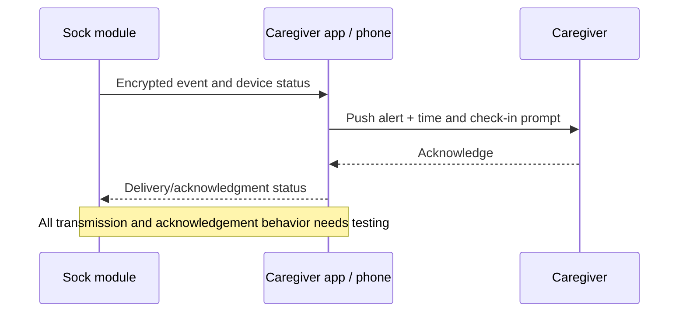

# Architecture

## Intended product concept

The sock includes grippy sole features, compression-inspired textile construction, thermal fabric and a removable sensor module. The software proof-of-concept here is **deliberately narrow**: USB IMU readings to a local Python fall-like motion detector.

## Data flow

1. **Motion:** MPU6050 accelerometer and gyroscope capture raw movement.
2. **Microcontroller:** ESP32 samples at approximately 20 Hz and streams CSV over wired USB serial.
3. **Experimental detector:** software checks a low-g interval, a high-g impact, and a period of low movement.
4. **Output:** a terminal prints a **test alert**. It is not a real notification to a caregiver.
5. **Evaluation:** labeled trial CSVs yield sensitivity, specificity, precision and false-positive rate **per non-fall trial**.

## Design gaps before any patient or everyday use

- Investigate whether a freefall-then-impact algorithm is suitable for a *foot-worn* sensor; foot motion during normal gait is distinct from other sensor placements.
- Test alternative event logic and ML models using participant-disjoint datasets.
- Account for sensor saturation, device orientation, sock slippage, and individual gait diversity.
- Add pairing, encryption, device provisioning, battery diagnostics and robust offline detection.
- Define the caregiver app, acknowledge/resolve workflow, retries, escalation and communications failure policy.
- Separate detecting a fall from **preventing** it. The anti-slip performance requires independent testing.
- Validate compression force and thermal comfort instead of asserting therapeutic effect.

## Intended future mobile workflow (not implemented)

